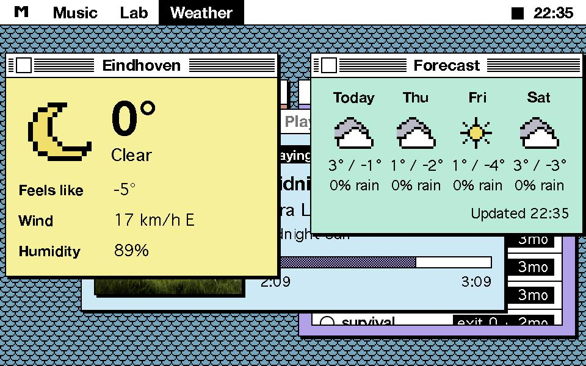
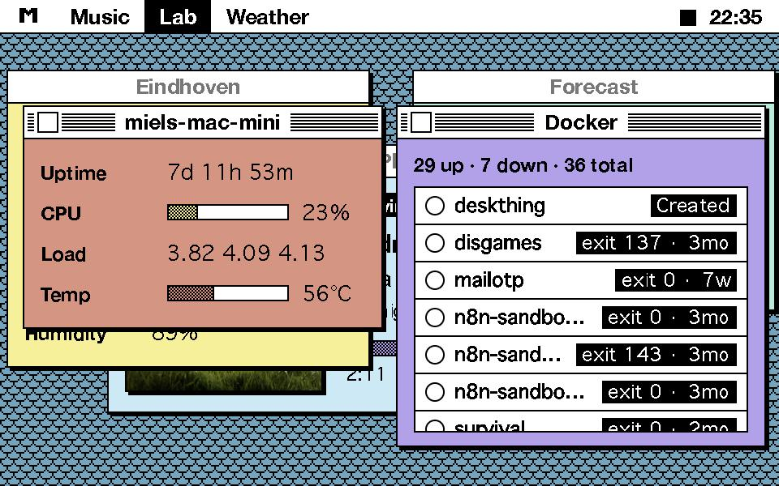

# OtherDeskThing

**A live desk dashboard for a 2010 iPod touch, styled as a colorized Macintosh System 7.**

OtherDeskThing turns an iPod touch that's stuck on iOS 6 into an always-on desk display. It shows what's playing on Spotify, the health of a Mac mini homelab and its Docker containers, and the local weather. Everything updates live, in a browser that predates `fetch`, `Promise` and modern TLS.





`Node.js` · `Server-Sent Events` · `ES5` · `CSS2 / -webkit- CSS3` · `Spotify Web API` · `Open-Meteo` · `Docker` · `Python (asset pipeline)` · **zero dependencies**

---

## Highlights

- **Runs on Mobile Safari 5.1/6.** Written in hand-written ES5 and CSS2, with no frameworks, bundlers or polyfills. The whole frontend is about 31 KB plus 3.8 KB of generated pixel art.
- **Live updates.** Server-Sent Events, with automatic fallback to XHR long-polling chosen by feature detection, plus a watchdog for buffering proxies.
- **Reaches modern services from a pre-TLS 1.2 device.** A small Node server acts as the bridge: it talks HTTPS to Spotify, Open-Meteo, Docker and macOS, and serves plain HTTP to the iPod. Album art is proxied too.
- **Pixel-faithful System 7 look on a 2011 rendering engine.** It has pinstriped title bars, Balloon Help, dithered meters and a cascading window desktop, all without CSS variables, gradients or `image-rendering`.
- **Debugged on real hardware.** One bug turned out to be HTTP pipelining in iOS 6 Safari. Remote logging from the device was what found it (see [Challenges](#challenges)).

## What it does

The iPod is used in landscape. Five windows live on one desktop, cascaded the way System 7 stacks them. Tapping a menu, or any window peeking out from behind, brings its group to the front. Windows that aren't in front go inactive, with no pinstripes and no close box, just like the original.

| Menu | Windows | Content | Refresh |
|---|---|---|---|
| **Music** | Now Playing | Current Spotify track: cover, title, artist and a progress bar animated on the client | 5 s while playing, pushed only on change |
| **Lab** | Mac mini, Docker | Uptime, CPU, load and CPU temperature; every container, with stopped or unhealthy ones on top | 5 s / 10 s / 15 s |
| **Weather** | Eindhoven, Forecast | Current conditions with pixel-art icons and a 4-day forecast | 10 min |

The menu bar keeps the original's 20 px height. Each menu still gets a 44 px tap target, through an invisible `:after` hit area that extends onto the desktop. A small square next to the clock shows the connection state: solid means live (SSE), dithered means polling, hollow means offline.

## Architecture

```
                       HTTPS                                   plain HTTP
 Spotify Web API  ◀──────────────┐                    ┌──────────────▶  iPod touch
 Open-Meteo       ◀──────────────┤   Node.js server   │   SSE stream     (iOS 6, Safari)
 Docker (socket/CLI) ◀───────────┤   on a Mac mini    ├── or long-poll
 macOS (os, macmon)  ◀───────────┘                    └── + static files, proxied album art
```

- **One state object.** The server merges music, lab and weather into a single versioned snapshot. Each change bumps the version and pushes the full snapshot to every SSE client and every waiting long-poll request.
- **Push only what matters.** Spotify is polled every 5 s, but a new song, play/pause or a seek is pushed only when it happens. The iPod animates the progress bar itself, against the server's clock, so a drifting device clock doesn't matter.
- **Graceful degradation.** EventSource is used when it exists. The client falls back to long-polling after repeated errors, when the stream closes for good, or when no heartbeat arrives for 40 s, which catches proxies that buffer the stream.
- **Bridging HTTPS.** Spotify's album art lives on HTTPS servers the iPod can't reach, so the server fetches the current cover once and serves it over HTTP. It only serves the current track's cover, so it isn't an open proxy.
- **Homelab sources.** Uptime, CPU and load come from Node's `os` module. Temperature comes from [macmon](https://github.com/vladkens/macmon), since Apple Silicon has no sudo-free temperature API. Containers come from the Docker socket, or the `docker` CLI when the engine runs under another macOS user over an SSH context.

## Challenges

### The album art that never loaded

The cover showed up on an iPhone, but never on the iPod. Server logs looked healthy, and a test page proved the iPod could decode the JPEG. So I instrumented the page to report each step back to the server via image beacons, and watched the request log while the iPod loaded it.

The log showed every beacon and the cover request reaching the server **at the same moment**: the moment the SSE connection closed, 117 seconds later. There was also only **one** TCP connection from the device. iOS 5/6 Safari uses **HTTP pipelining**: it queued the image request on the keep-alive connection behind an SSE response that never ends.

The fix was a single header: `Connection: close` on every response, so no request can ever queue behind the stream. On a LAN, a new connection per request costs practically nothing. The same rule had to go into the reverse-proxy configs (`keepalive_timeout 0` for nginx).

Two smaller iOS 5/6 quirks came up along the way:

- **Never-ending loading spinner.** Starting the stream during page load keeps Safari's loading spinner turning forever, so the stream now starts after `load`.
- **Hidden images.** Old Safari may never load an image that's hidden with `display:none`. Covers now use `visibility:hidden` while they load.

### System 7 without modern CSS

The look normally relies on CSS variables, `repeating-linear-gradient` and `image-rendering: pixelated`, and none of these exist on iOS 5. Instead, a small **Python asset pipeline** ([tools/make-assets.py](tools/make-assets.py), standard library only, with its own PNG encoder) draws every pattern and icon from ASCII art:

- **Scaling rule.** Patterns are drawn at 2 image pixels per art pixel and shown at 1 CSS px. Icons are drawn at 8 per art pixel. Every downscale is then an exact integer box filter, so pixels stay crisp on both retina and non-retina screens without `image-rendering`.
- **Dither with holes.** The 50% dither has transparent holes, so one 79-byte PNG over any background color makes colored dithered meters.
- **Logo.** It's generated too: a solid black glyph for the menu bar, and an outlined version with a hard shadow for the Home Screen icon.

Hard 2 px shadows, 1 px ink borders, inverted selections and Balloon Help tails built from CSS2 border triangles complete the look.

### Fitting a desktop into 480×279

Every window has a fixed position on a fixed-size desktop, chosen so that:

- **Each group fits completely** on screen when it's in front.
- **Every group behind keeps a visible title bar** to tap.
- **Content stays inside its window:** song titles are capped at two lines, and the Docker list scrolls inside its window with `-webkit-overflow-scrolling: touch`.

In portrait, the same markup falls back to a single stacked column showing only the front group.

## Constraints

| Area | Rule | Why |
|---|---|---|
| Transport | Plain HTTP; no HTTPS, HSTS or redirects | iOS 5/6 can't negotiate modern TLS or trust current root certificates |
| Realtime | SSE + long-poll; no WebSockets | iOS 5 only speaks the obsolete Hixie-76 WebSocket draft |
| JavaScript | ES5 only: `var`, `XMLHttpRequest`, `onreadystatechange` | No `let`/`const`, arrows, template literals, `fetch`, `Promise`, classes, or even `Function.prototype.bind` |
| CSS | CSS2 + `-webkit-` prefixed CSS3 | No flexbox, grid, variables, `calc()`, `vh`/`vw` |
| Connections | `Connection: close` everywhere | iOS 5/6 HTTP pipelining (see above) |
| Caching | `no-store` headers + timestamp cache-busters | Old Mobile Safari caches XHR aggressively |
| Safety | `textContent` only, never `innerHTML` | Song titles and container names are untrusted input |

<details>
<summary>Full list of deliberately avoided features</summary>

**JavaScript**
- `let`/`const`, arrow functions, template literals, classes, modules, destructuring, spread, default parameters
- `fetch`, `Promise`, `async`/`await`
- `Function.prototype.bind` (missing in Safari 5.1) and `classList`
- `XMLHttpRequest.timeout` and XHR `onload`/`onerror`; timeouts use `setTimeout` + `abort()`
- Named SSE events; heartbeats are plain `message` events
- ISO date parsing (unreliable in Safari 5.1); the server sends weekday names and timestamps
- Page Visibility API, `requestAnimationFrame`, `Date.now()`, `toLocaleTimeString`
- `localStorage` for anything important; it only remembers the front window group
- User-agent sniffing, polyfills, frameworks, bundlers

**CSS**
- Flexbox (including `-webkit-box`), grid, custom properties, `calc()`, `vh`/`vw`, `rem`
- `repeating-linear-gradient`, `image-rendering: pixelated`
- Unprefixed-only CSS3, `position: fixed`, hover-only interactions
- Web fonts by default; the Chicago font is optional (`ChicagoFLF.ttf` in `public/fonts/`)

**Network**
- HTTPS, HSTS, redirects, keep-alive, third-party resources on the page

</details>

## Project structure

```
server.js          HTTP server: static files, /api/state, /api/events, /api/cover
spotify.js         Spotify Web API client (refresh-token flow, currently playing)
spotify-auth.js    One-time OAuth helper that stores a refresh token
lab.js             Host stats and Docker container status
weather.js         Open-Meteo client with WMO code → label/icon mapping
public/
  index.html       The desktop: menu bar and five windows
  style.css        The System 7 look in iOS 5-safe CSS
  app.js           ES5 client: SSE/long-poll, window stacking, rendering
  img/             Generated pixel art (patterns, logo, weather icons)
tools/
  make-assets.py   Pixel-art pipeline (stdlib-only PNG encoder)
Dockerfile, docker-compose.yml
```

About 2,400 lines in total, with no runtime or build dependencies.

## Running it

**Requirements:** Node.js 22.9+, a Spotify account, and optionally Docker and [macmon](https://github.com/vladkens/macmon) for the Lab windows. The client targets iOS 5–6. It was tested on an iPod touch (4th gen) running iOS 6.1.6, and works in any modern browser too.

1. **Spotify app.**
   1. Create an app in the [Spotify Developer Dashboard](https://developer.spotify.com/dashboard), choose **Web API**, and add the redirect URI `http://127.0.0.1:8889/callback`.
   2. Copy the settings file and fill in the Client ID and Client Secret:
      ```bash
      cp .env.example .env
      ```
   3. Authorize once (read-only scopes):
      ```bash
      npm run spotify-auth
      ```
2. **Start the server.**
   ```bash
   npm start
   ```
   Run it natively for real host stats; inside a container, Node only sees the Docker VM. `docker compose up -d --build` also works for the Music and Weather windows.
3. **Open it on the device.** Browse to `http://<server-LAN-IP>:8080`, then use **Add to Home Screen** for full-screen landscape. Add `#lab` or `#weather` to the URL to choose the starting group, or `?poll=1` to force the polling fallback.

| Variable | Default | |
|---|---|---|
| `PORT` / `HOST` | `8080` / `0.0.0.0` | Listen address |
| `SPOTIFY_CLIENT_ID` / `SPOTIFY_CLIENT_SECRET` | – | Spotify app credentials |
| `HOST_LABEL` | hostname | Title of the host window |
| `DOCKER_IGNORE` | – | Comma-separated containers to hide |
| `DOCKER_SOCKET` / `DOCKER_BIN` | `/var/run/docker.sock` / auto | Docker access |
| `TEMP_COMMAND` | macmon | Any command printing the CPU temperature in °C |
| `WEATHER_NAME` / `WEATHER_LAT` / `WEATHER_LON` / `WEATHER_TZ` | Eindhoven | Weather location |
| `LOG_REQUESTS` | off | Per-request log, handy for debugging on the device |

<details>
<summary>Serving it on its own HTTP-only hostname</summary>

A reverse proxy in front must:

- **Stay on plain HTTP:** no HTTPS redirect, no HSTS. Avoid HSTS-preloaded TLDs such as `.dev` or `.app`, and parents that send `includeSubDomains`. A local name like `OtherDeskThing.home.lan` is safest.
- **Not buffer the SSE stream.**
- **Not keep client connections alive,** because of the pipelining issue above.

nginx:

```nginx
server {
    listen 80;
    server_name OtherDeskThing.home.lan;
    keepalive_timeout 0;                 # no pipelining from iOS 5/6

    location / {
        proxy_pass http://127.0.0.1:8080;
        proxy_http_version 1.1;
        proxy_set_header Connection "";
        proxy_set_header Host $host;
        proxy_buffering off;             # SSE
        proxy_read_timeout 1h;
    }
}
```

Caddy (untested on the device):

```
http://OtherDeskThing.home.lan {
    header Connection close
    reverse_proxy host.docker.internal:8080 {
        flush_interval -1
    }
}
```

</details>

The dashboard is unauthenticated and unencrypted by design (the device can't do better), so it's meant to stay on a home network.
